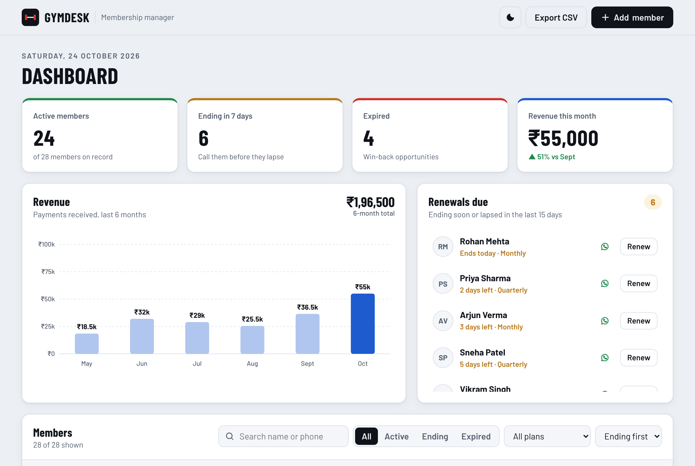
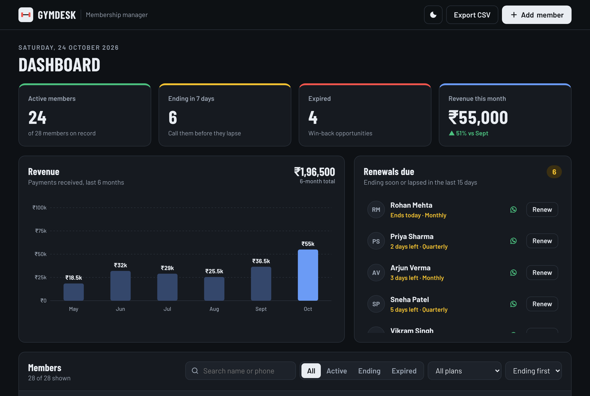
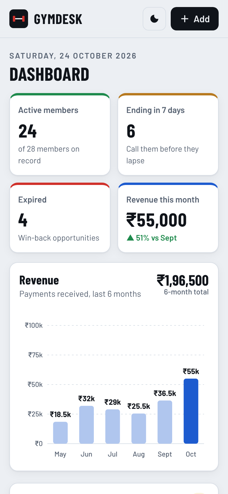

# GymDesk: Gym Membership Dashboard

A dashboard for small gyms to see who is active, whose membership is about to run out, and how much money came in this month, without a spreadsheet.

**[Live demo →](https://coach-who-codes.github.io/gym-manager-dashboard/)** (loads with realistic demo data)

[](https://github.com/coach-who-codes/gym-manager-dashboard/actions/workflows/test.yml)




## Why I built it

I'm a personal trainer who also sells gym memberships, so I see this problem up close. Memberships run out quietly, nobody follows up, and the member just stops coming. Many small gyms track this in a notebook or a messy Excel sheet. GymDesk puts the three questions an owner asks every morning on one screen:

1. **Who is about to expire?** Members ending in the next 7 days, sorted by urgency.
2. **Who already lapsed?** Members who are easy to win back if someone calls them this week.
3. **How is revenue trending?** Payments over the last 6 months.

## Features

- **KPI cards:** active members, members ending this week, expired members, and this month's revenue compared with last month
- **Renewals due list** with a one-tap **WhatsApp reminder**: it opens a pre-written message to the member with their plan and end date
- **Renew in one step:** if a member renews early, their unused days carry over, so nobody loses days they paid for
- **Members table** with search (name or phone), status filter, plan filter and sorting. On phones it turns into cards.
- **Revenue chart:** a hand-built SVG bar chart that redraws at any screen width
- **Add, edit and remove members** in accessible `<dialog>` forms with validation
- **Export to CSV** to open in Excel or Google Sheets
- **Light and dark mode** that follows the system setting, with a manual toggle
- Data is saved in `localStorage`, so it survives a refresh, and nothing leaves the browser

<p align="center">
  
  &nbsp;
  
</p>

## How it's built

Plain HTML, CSS and JavaScript (ES modules), with no framework and no build step. I kept the business logic separate from the UI so it can be tested on its own:

```
gym-manager-dashboard/
├── index.html          # page structure and dialogs
├── styles.css          # design tokens, light/dark themes, responsive layout
├── src/
│   ├── members.js      # pure logic: status, renewals, revenue, filtering, CSV, WhatsApp links
│   ├── store.js        # localStorage persistence and seeded demo data
│   ├── chart.js        # dependency-free SVG bar chart
│   └── app.js          # rendering and event handling
└── tests/
    └── members.test.js # unit tests (Node's built-in test runner)
```

Some decisions worth mentioning:

- **Dates are calculated in UTC** (`yyyy-mm-dd` strings), so a membership never gains or loses a day because of time zones.
- **Renewals stack.** Renewing on day 25 of a 30-day plan starts the new period on day 30, not today. A test covers this.
- **Demo data is generated relative to today** with a seeded random generator, so the demo always shows a believable mix of active, expiring and expired members.
- **Accessibility:** semantic table, labelled controls, `role="radiogroup"` filters, visible focus rings, `aria-live` toasts and reduced-motion support.

## Run it locally

```bash
git clone https://github.com/coach-who-codes/gym-manager-dashboard.git
cd gym-manager-dashboard
npx serve .        # or any static server, then open the printed URL
```

## Tests

```bash
npm test
```

13 unit tests cover date maths across month and year boundaries, status rules, early and late renewals, revenue grouping, filtering and sorting, CSV escaping and the WhatsApp link format. GitHub Actions runs them on every push.

## Next steps

- [ ] Sync data to a backend (Firebase or Supabase) so staff can share it across devices
- [ ] Attendance check-ins with a QR code at the front desk
- [ ] Payment links (Razorpay) sent with the renewal reminder

## License

MIT © Amit Dubey
